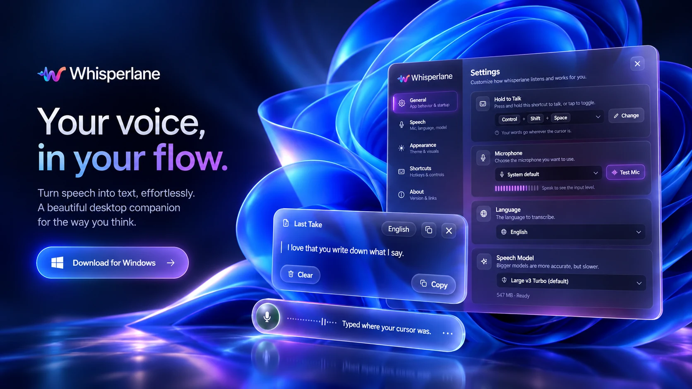
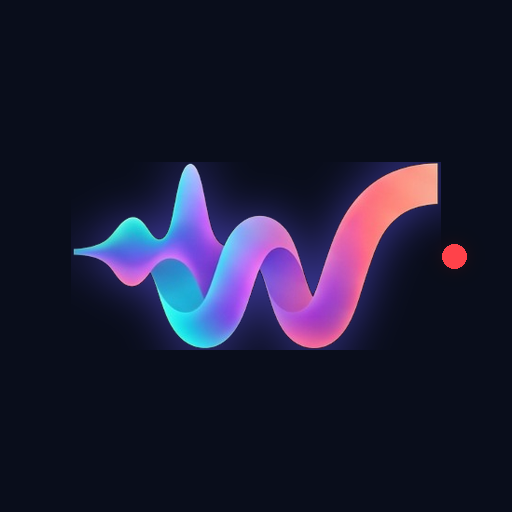
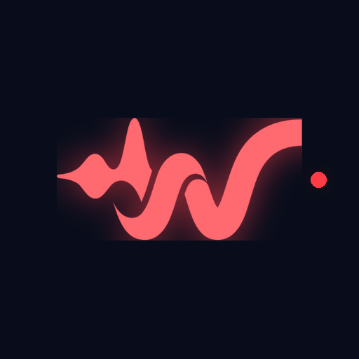
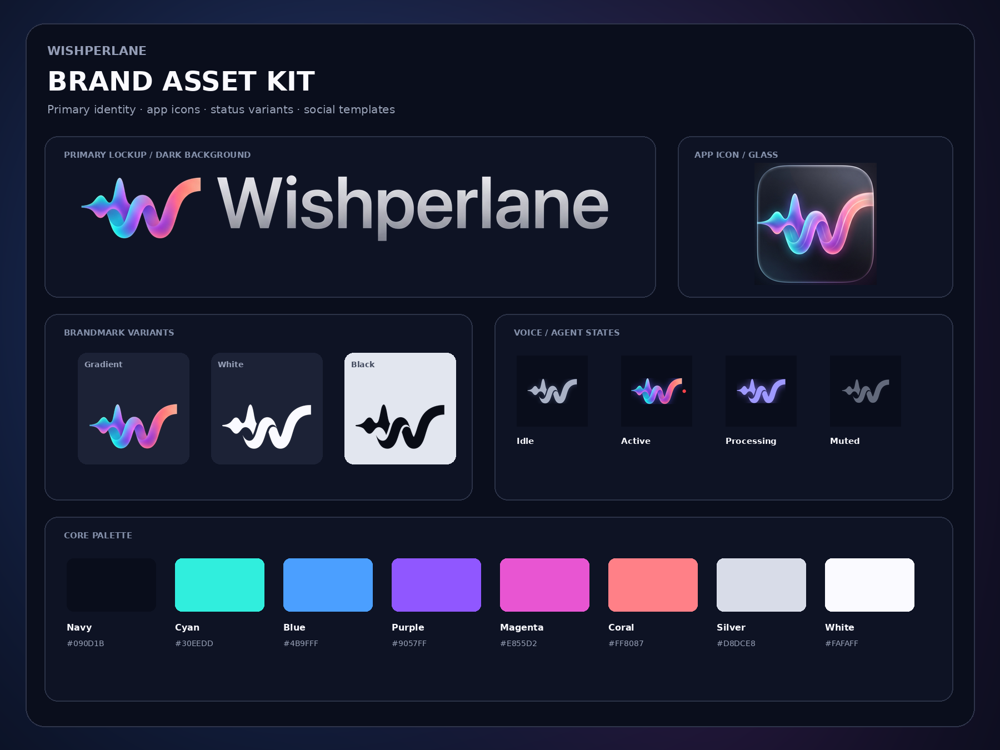
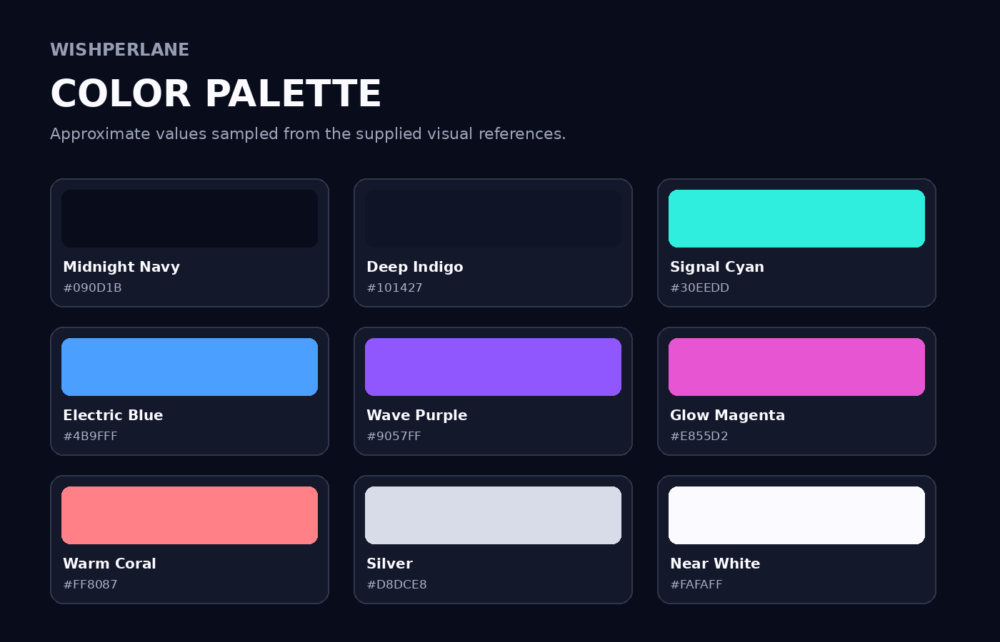
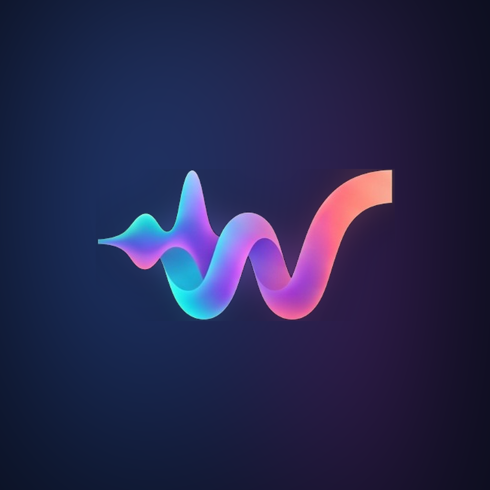
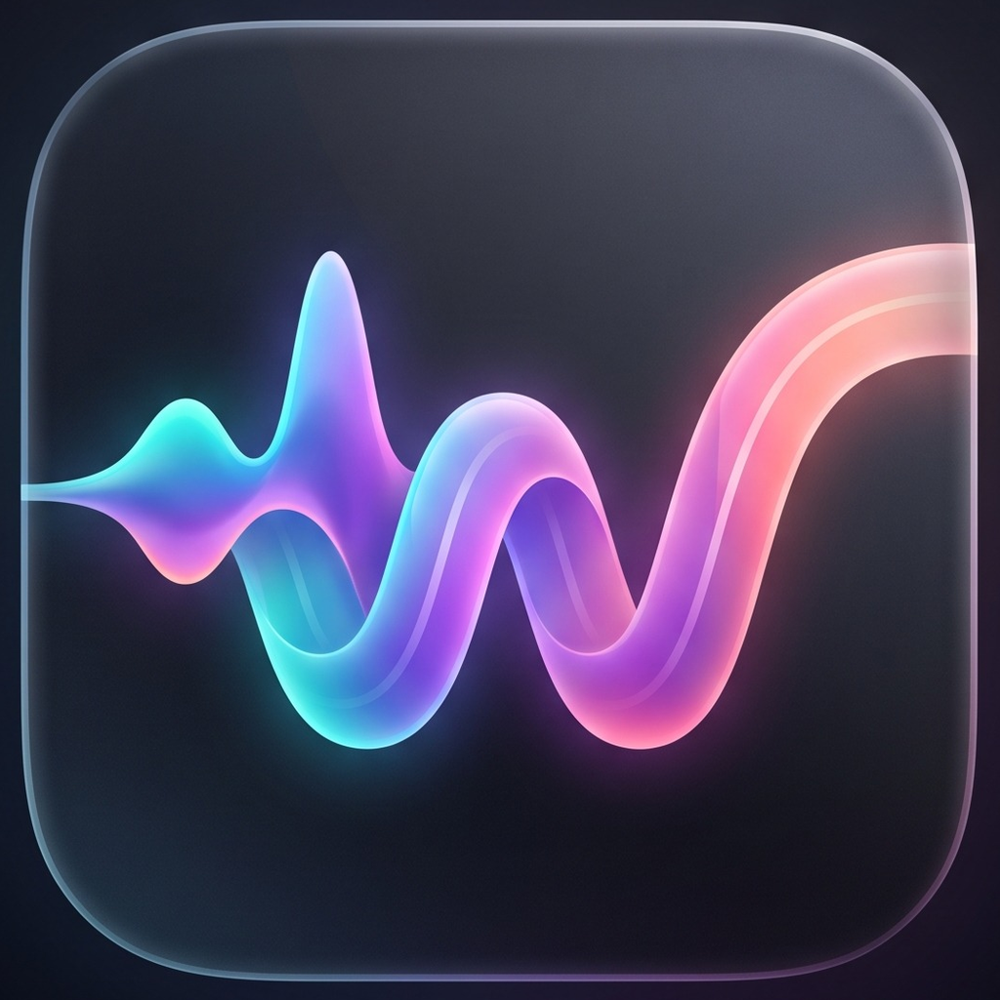
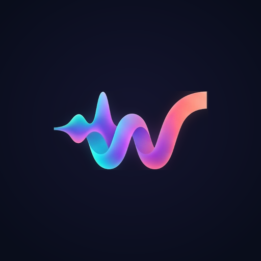
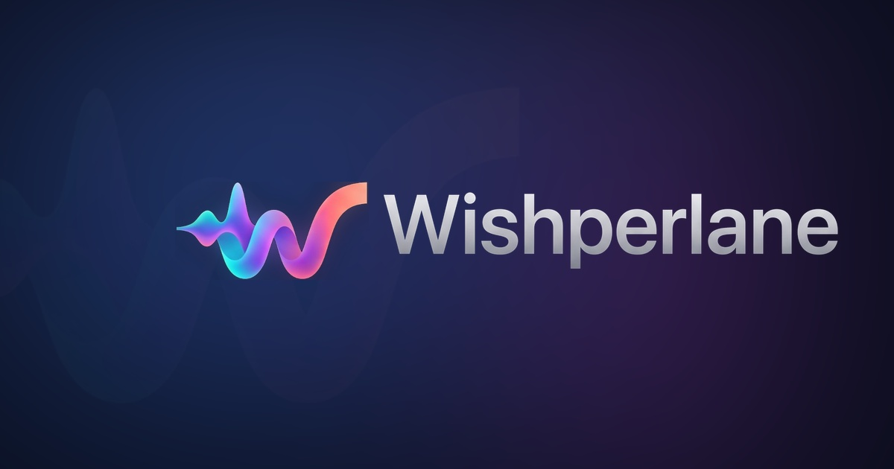

<p align="center">
  <picture>
    <source media="(prefers-color-scheme: dark)" srcset="brand-kit/01_Logos/PNG/whisperlane-lockup-horizontal-on-dark.png">
    <source media="(prefers-color-scheme: light)" srcset="brand-kit/01_Logos/PNG/whisperlane-lockup-horizontal-on-light.png">
    
  </picture>
</p>

<p align="center">
  <b>Hold a key, talk, and it is typed.</b><br>
  <sub>Free, open source, local-first dictation for Windows — wherever your caret already is.</sub>
</p>

<p align="center">
  <a href="https://learn.microsoft.com/en-us/windows/"></a>
  <a href="https://tauri.app"></a>
  <a href="https://www.rust-lang.org"></a>
  <a href="LICENSE-MIT"></a>
  <a href="https://github.com/fahrim/whisperlane/releases/latest"></a>
</p>

<p align="center">
  
</p>

whisperlane is a dictation tool for people who write in a terminal. Press the
chord, speak, release — the words appear where your caret already was. No
window to open, no account to make, no round trip to a server. It runs on
your machine, on your GPU, and it is free.

It is built for the way developers actually write: short bursts, half-formed
thoughts, a sentence aimed at a file, a commit message, a prompt for the
agent on the other side of the terminal.

```text
Ctrl + Shift + Space  →  hold, speak, release  →  typed at the caret
Escape                →  throw the take away, type nothing
```

## Why another one

Two things were missing from the dictation tools that already exist.

**Windows graphics coverage.** Most accelerated speech tooling assumes one
vendor. whisperlane walks the backends on your machine — CUDA where it is
there, **Vulkan for AMD and Intel**, CPU as the floor — so the fast path is
not reserved for one brand of card.

**A shorter path to the agent.** Dictation should reach the thing you are
talking to, not the thing that happens to be in front. That starts with the
caret and continues, in this product's own scope, with a direct agent
target.

## What it does

| Feature | What it does |
| --- | --- |
| **Hold or toggle** | Hold the chord to talk, tap it to start and stop, or cancel with `Escape` before anything is typed. |
| **Types where you are** | One destination today: the focused window. Editor, browser, terminal, or the agent running inside it. |
| **Runs locally** | Transcription on your GPU. After setup, everyday dictation needs no network. |
| **No account** | No sign-in, no sync, no telemetry. Your settings and models live in your user profile. |
| **Honest progress** | Model downloads and updates report what is actually happening, and never start without you asking. |
| **Signed updates** | Updates are verified against a key shipped in the app. An unsigned or tampered download is refused. |

## Dictation that reaches the agent

Today, whisperlane types into the focused window — and an agent's terminal is
a window, so it works there with no special mode and no integration work.

What comes next is a **direct agent target**: dictating into an open agent
session without moving focus to its window first. Same take, same chord,
same transcription — the words are delivered to the agent rather than to
whatever is frontmost. No model in the middle, no rewriting, no autonomous
work. Only the target changes, and it stays free.

Turning a spoken sentence into a planned task and running it across several
agents is a different problem. It is not on this roadmap.

## For tool builders

Most dictation tools are a dead end: the text goes into a box and stays
there. whisperlane can publish each finished transcript as one JSON line on
loopback, so anything you are building can read what was just spoken.

```
{"version":"1.0","event":"transcript","text":"…","timestamp":1710000000000}
```

Off by default, enabled in **Settings → Integrations**, text only — a
subscriber can read, and cannot ask whisperlane to do anything. The contract
is versioned and deliberately small, so the next thing built on it does not
have to change this application.

## Install

**Windows installer.** Grab it from the [latest release](https://github.com/fahrim/whisperlane/releases/latest).
Builds are signed for the updater, and every release carries a
`SHA256SUMS.txt` beside the installers so the download can be checked.

**Scoop.**

```powershell
scoop bucket add whisperlane https://github.com/fahrim/scoop-whisperlane
scoop install whisperlane
```

If you install through Scoop, update through Scoop as well. The in-app updater
works, but it installs over the Scoop-managed copy and `scoop status` will
then report a mismatch.

The app is a Windows MVP. macOS and Linux are not supported yet, and the
settings that exist are the ones the flows need — not a control panel.

## Build from source

Requires [Rust](https://rustup.rs), [Bun](https://bun.sh), and the WebView2
runtime that ships with Windows 10 and 11.

```bash
cd apps/desktop
bun install
bun run tauri build
```

A bundle build also needs the updater signing key. Everything else — the
type check, the linter, and the tests — does not:

```bash
cargo test        # inside apps/desktop/src-tauri
```

## Milestones

| Milestone | Scope | Status |
| --- | --- | --- |
| M0 — skeleton that talks | Shell, tray, hotkey, capture, GPU transcription, clipboard delivery | ✅ Done |
| M1 — useful on Windows | Settings, chord, microphone, hold/toggle/cancel, insertion, model download, AMD/Intel acceleration | ✅ Done |
| M2 — polish and packaging | First run, pill states, premium pass, packaging | ✅ Released as v0.8.0 |
| Phase 2 — direct agent target | Dictate into an open agent session without moving focus first | ⏳ Planned |
| M3 — wider platforms | macOS, then Linux, signing and notarization | ⏳ Planned |

## Documentation

The project is documented before it is built. Start with the source plan,
then read the numbered set.

| Document | Purpose |
| --- | --- |
| [`docs/plan/pre-start-intro-plan.md`](docs/plan/pre-start-intro-plan.md) | Single source of truth for what we are building and why |
| [`docs/01-vision.md`](docs/01-vision.md) | Mission, vision, v1 goals, success measures, non-goals |
| [`docs/02-audience.md`](docs/02-audience.md) | Target users, personas, usage scenarios |
| [`docs/03-product.md`](docs/03-product.md) | Scope, features, boundaries, positioning |
| [`docs/04-experience.md`](docs/04-experience.md) | UX principles, flows, states, premium feel |
| [`docs/05-architecture.md`](docs/05-architecture.md) | Components, data flow, technology choices |
| [`docs/06-agent-integration.md`](docs/06-agent-integration.md) | The direct agent target and the destination abstraction |
| [`docs/07-roadmap.md`](docs/07-roadmap.md) | Milestones with acceptance criteria |
| [`docs/08-decisions.md`](docs/08-decisions.md) | What is decided, what is open, and why |
| [`docs/09-repository.md`](docs/09-repository.md) | Layout, licensing, contribution, release |

## The pill

Every state is legible from one small indicator.

<p align="center">
  
  
  
  
  
</p>

<p align="center">
  <sub>Idle · Listening · Processing · Muted · Error</sub>
</p>

## Brand

The brand kit lives in [`brand-kit/`](brand-kit/): logo lockups, app icons,
status states, social sizes, and the guidelines below.

<p align="center">
  
</p>

<p align="center">
  
</p>

<p align="center">
  
  
  
  
</p>

<p align="center">
  <sub>Flat · Glass · Maskable · Favicon</sub>
</p>

See [`brand-kit/README.md`](brand-kit/README.md) and
[`brand-kit/ASSET_INDEX.md`](brand-kit/ASSET_INDEX.md) for usage notes.

## Social preview

<p align="center">
  
</p>

## License

Dual-licensed under [MIT](LICENSE-MIT) or [Apache License 2.0](LICENSE-APACHE),
following the common Rust-ecosystem convention. Licensing texts travel with
every distribution.

---

<p align="center">
  <sub>If whisperlane saves you a sentence, a star helps someone else find it.</sub>
</p>

<sub>whisperlane — a quiet tool that is mostly invisible, feels finished, and
respects the machine it runs on.</sub>
